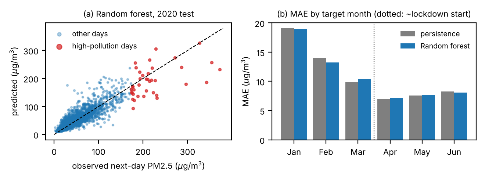
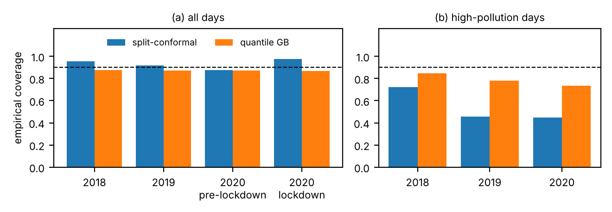

# Air Quality Analysis and Prediction: next-day PM2.5 forecasting in Indian cities

[](https://colab.research.google.com/drive/1bbHlQcyPjlq7UUU4D_Aegft_wqfDwb4U?usp=sharing)

ES 678 course project (graduate track, individual research paper) by **Divyanshu Kumar (26510041)**.
The four-page paper is [`paper/es678_project.pdf`](paper.pdf).
## The question

Can today's pollutant readings and calendar information predict **tomorrow's city-level PM2.5** in Indian cities
more accurately than **persistence** (tomorrow = today)?

* **One row** = one city on one day (CPCB daily data, 17 cities kept out of 26).
* **Target** = PM2.5 on the next day (regression, in ug/m3).
* **Prediction time** = end of day *t*; only information up to day *t* is used.
* **Scope of the claim** = predictive association for these cities and this period, not the causes of pollution.

## Main finding

The best learned model (random forest, chosen on the 2019 validation year) **only ties persistence** on the held-out
2020 test period.

| 2020 test (n = 3013) | MAE | RMSE | Skill vs persistence (95% block-bootstrap CI) |
|---|---|---|---|
| Persistence | 11.03 | 18.35 | 0 (reference) |
| City-month mean | 34.83 | 45.22 | -2.159 [-2.635, -1.870] |
| Ridge | 12.12 | 18.51 | -0.099 [-0.144, -0.061] |
| **Random forest** | **10.98** | **17.51** | **+0.004 [-0.018, +0.030]** |
| Gradient boosting | 11.12 | 17.72 | -0.008 [-0.042, +0.022] |

*Skill = 1 - MAE(model) / MAE(persistence); a value above 0 means better than persistence. MAE and RMSE are in ug/m3.*

Selected hyperparameters (tuned on 2019 only): ridge alpha = 100; random forest 300 trees, max_features 0.5,
max_depth = 14, min_samples_leaf = 10; gradient boosting subsample 0.8, n_estimators = 150, learning_rate = 0.1, max_depth = 4.

**Graduate-depth analysis (all on the same task):**

1. **Lag-feature ablation.** More history helps: forest test MAE is 12.1 (today only), 11.4 (lags 1-3), 11.0 (lags 1-7).
2. **Failure-mode audit.** Peaks are under-predicted: on the 38 high-pollution test days (target above the 172.6 ug/m3
   training 90th percentile) the forest is too low on 71% of days (mean bias -28.6 ug/m3).
3. **Prediction intervals.** 90% split-conformal intervals cover 0.93 of test days overall but only 0.45 of high-pollution
   days; quantile gradient boosting covers 0.87 overall and 0.74 of high days because its width adapts.

<p align="center">
  
</p>
<p align="center">
  
</p>

## Data

* **Source:** *Air Quality Data in India (2015-2020)*, file `city_day.csv`, Kaggle dataset by R. Rao, built from data made
  public by the Central Pollution Control Board (CPCB), India. Free Kaggle account needed.
* **Size:** 29,531 rows, 26 cities, 2015-01-01 to 2020-07-01; 12 pollutant columns plus AQI and AQI_Bucket.
* **Quality issues found:** PM2.5 missing in 15.6% of rows (xylene 61%, PM10 38%, NH3 35%); uneven city coverage (nine
  cities have no PM2.5 in 2015-2018); no duplicate city-days; calendar gaps within cities.
* **Privacy:** public data, no personal information. `AQI` / `AQI_Bucket` are never used (computed from the same pollutants).

## Method in brief

| Step | Choice and reason |
|---|---|
| Split | Chronological, by target date: train 2015-2018, validation 2019, test 1 Jan-1 Jul 2020. Random splits would leak neighbouring days. |
| Usable rows | PM2.5 observed on day *t* and *t+1*, so persistence exists and all methods are scored on identical rows (13,124 / 6,040 / 3,013). |
| Cities | Keep cities with at least 200 usable training rows (17 kept; the 9 dropped are listed in `results/run_summary.json`). |
| Features | Day-*t* pollutants, PM2.5 lags 1-7, trailing 3- and 7-day means, cyclic month and weekday, city. |
| Leakage control | Past-only forward fill (max 3 days); medians, scaling, one-hot encoding and the "drop features missing in more than 50% of training rows" rule are fit on training only (drops xylene). Verified by `tests/test_leakage.py`. |
| Baselines | Persistence; city-month mean from training data. |
| Models | Ridge, random forest, gradient boosting; hyperparameters tuned on 2019 only; test set touched once. |
| Stability | Rolling-origin checks (validate 2017, 2018). |
| Metrics | MAE, RMSE, MAE on high-pollution days, skill vs persistence; moving-block bootstrap (7-day blocks, 2000 draws) for 95% CIs. |
| Lockdown | 2020 reported overall, before 25 March and during the lockdown. |
| Intervals | Quantile gradient boosting (5%, 95%) and split-conformal (calibrated on the year before each test window). |

## Repository layout

```
.
├── README.md                          this file
├── requirements.txt
├── data/README.md                     how to get city_day.csv (file not committed)
├── src/aq_pipeline.py                 all functions (data, features, models, metrics, intervals)
├── scripts/
│   ├── run_all.py                     runs every experiment; writes results/, paper figures and tables
│   ├── verify_headline.py             independent recomputation of headline metrics
│   └── make_notebook.py               rebuilds the Colab notebook
├── notebooks/air_quality_colab.ipynb  all code in one runnable notebook
├── tests/test_leakage.py              leakage, split and conformal checks
├── results/                           all saved outputs (see below)
└── paper/                             LaTeX source, course style file, PDF, generated tables and figures
```

### What is in `results/`

| File | Content |
|---|---|
| `run_summary.json` | split dates and sizes, kept/dropped cities, dropped feature, selected hyperparameters, versions, seed |
| `audit_*.csv`, `kept_cities_rows.csv` | data-quality checks and rows per city and split |
| `tuning_*.csv` | validation MAE for every hyperparameter setting |
| `val_metrics.csv`, `test_metrics_*.csv` | metrics with bootstrap CIs (all test, pre-lockdown, lockdown) |
| `rolling_origin.csv` | stability folds (validate 2017, 2018) |
| `ablation_lags.csv` | lag-feature ablation |
| `failure_audit_*.csv`, `per_city_*.csv` | error analysis by group, month, city and worst days |
| `interval_coverage.csv` | interval coverage and width per window and subgroup |
| `test_predictions.csv` | every test prediction of every model |
| `run_log.txt` | full console log of the run |

## Reproduce

```bash
pip install -r requirements.txt     # tested: Python 3.12, numpy 2.5, pandas 3.0, scikit-learn 1.9, matplotlib 3.11
# download city_day.csv from Kaggle into data/   (see data/README.md)
python tests/test_leakage.py        # 6 checks, a few seconds
python scripts/run_all.py           # all experiments, about 10 minutes on one CPU core
python scripts/verify_headline.py   # recomputes headline MAE and skill from saved predictions
upload the Latex_Source_file.zip and compile in overleaf
```

* **Colab:** use the badge above, choose *Runtime > Run all*, and upload `city_day.csv` when asked.
* **Overleaf:** upload the `paper/` folder and set `es678_project.tex` as the main file.
* All random seeds are 42; the full run was repeated and gave identical numbers. Results may differ in the last digit
  with other library versions.

## Limitations

* The test window is six months, has no October-December winter peak, and includes the COVID-19 lockdown.
* Only 38 high-pollution test days, so conclusions about peaks are uncertain.
* Uneven city and station coverage over time; no meteorology in the data; models use squared loss but are scored by MAE.
* Prediction is not causation.

## AI-use disclosure

Claude (Anthropic) assisted with planning, writing and debugging the code, the LaTeX source and the documents in this
repository. Details and the checks performed are in [`AI_DISCLOSURE.md`](AI_DISCLOSURE.md). The author is responsible
for all content.

## Citations

* R. Rao. *Air Quality Data in India (2015-2020)*. Kaggle dataset, data made public by the Central Pollution Control
  Board, India. <https://www.kaggle.com/datasets/rohanrao/air-quality-data-in-india>
* F. Pedregosa et al. Scikit-learn: Machine learning in Python. *JMLR* 12:2825-2830, 2011.
* A. E. Hoerl and R. W. Kennard. Ridge regression: Biased estimation for nonorthogonal problems. *Technometrics* 12(1):55-67, 1970.
* L. Breiman. Random forests. *Machine Learning* 45(1):5-32, 2001.
* J. H. Friedman. Greedy function approximation: A gradient boosting machine. *Annals of Statistics* 29(5):1189-1232, 2001.
* R. Koenker and G. Bassett. Regression quantiles. *Econometrica* 46(1):33-50, 1978.
* J. Lei et al. Distribution-free predictive inference for regression. *JASA* 113(523):1094-1111, 2018.
* R. F. Barber, E. J. Candes, A. Ramdas and R. J. Tibshirani. Conformal prediction beyond exchangeability. *Annals of Statistics* 51(2):816-845, 2023.
* H. R. Kunsch. The jackknife and the bootstrap for general stationary observations. *Annals of Statistics* 17(3):1217-1241, 1989.

No passwords, API keys or private data are used or stored in this repository.
